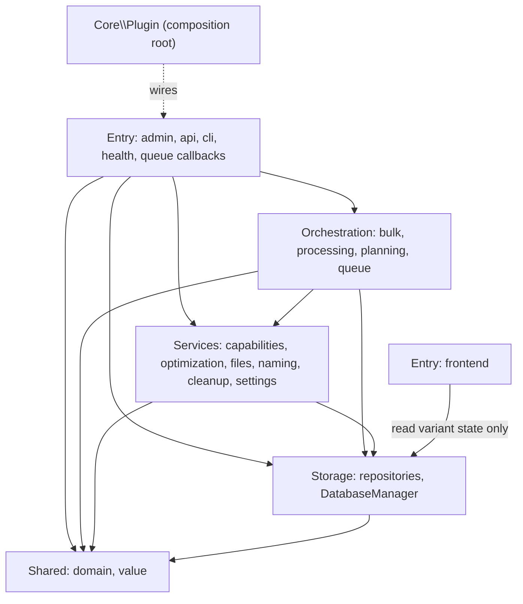
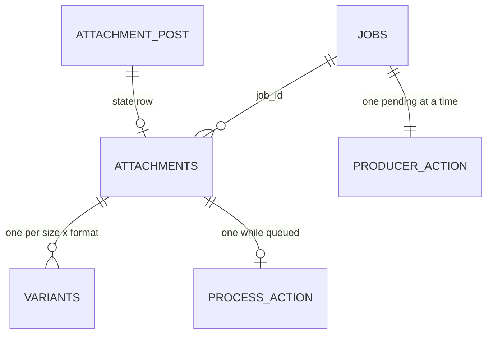
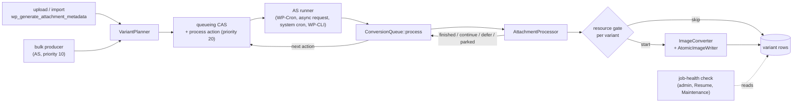

# Architecture Spine — TrustOptimize

## Design Paradigm

**Layered WordPress plugin with one composition root.** `Core\Plugin` builds every service through constructors and registers hooks. Background work is **producer–consumer on Action Scheduler (AS)**: producers hand attachment IDs to the queue, one AS action converts one attachment. Persistent state lives in **state machines in the plugin's own tables**, changed by **compare-and-set (CAS)** updates in repositories wherever writers can race.

| Layer | Namespaces (`includes/`) | Role |
| --- | --- | --- |
| Entry | `admin` (screens, notices, statistics), `api`, `cli`, `frontend`, `health`, `queue` (hook callbacks) | WordPress hooks, REST, WP-CLI, screens, delivery |
| Orchestration | `bulk`, `processing`, `planning`, `queue` | jobs, producer, worker loop, gate, planning, lifecycle, maintenance |
| Services | `capabilities`, `features/optimization`, `files`, `naming`, `service`, `settings`, `utils`, `Admin\Settings` (option reader) | conversion, file writes and cleanup, capability, settings |
| Storage | `storage`, `bulk/BulkJobRepository`, `database` | tables, CAS methods, schema |
| Shared | `domain`, `value` | status constants, result objects |

## Invariants & Rules



### AD-1 — One composition root, layered dependencies [ADOPTED]

- **Binds:** all
- **Prevents:** hidden service instances with diverging configuration; new upward dependencies; the front end writing files.
- **Rule:**
  - Services are created only in `Core\Plugin` and passed through constructors. The only exceptions are the static `Lifecycle::deactivate()` and `uninstall.php`, which run without the plugin booted.
  - Dependencies point down the diagram above. New code adds no upward edge. Existing exceptions at 0943f8c:
    - `Admin\Settings` is the option reader for every layer;
    - `VariantRepository` uses `OptimizationSettings`;
    - `ImageCleanupService` cancels tasks through `ConversionQueue`;
    - `Admin\Statistics` uses `PictureRenderer`.
  - Front-end rendering never writes files or loads an image editor; it only reads variant state.

### AD-2 — Plugin tables are the single source of truth [ADOPTED]

- **Binds:** storage, planning, processing, bulk, admin, REST, WP-CLI
- **Prevents:** two copies of state that drift (postmeta vs tables, stored counters vs rows).
- **Rule:**
  - Attachment, variant and job state lives in the tables `trust_optimize_attachments`, `trust_optimize_variants` and `trust_optimize_jobs` (behind the site prefix). Nothing is stored in postmeta.
  - The attachment state is derived from its variant rows by `recompute()`.
  - Job progress is derived from attachment states by `job_id`, or from the cursor (`JobProgress`). It is never stored as counters. Admin, REST and WP-CLI keep their progress fields, filled from `JobProgress`.

### AD-3 — State changes that can race are repository CAS [ADOPTED]

- **Binds:** storage, bulk, queue, processing, cleanup
- **Prevents:** lost updates and double work between concurrent workers, admin requests and WP-CLI.
- **Rule:**
  - Transitions that several writers can attempt are conditional `UPDATE … WHERE <expected state>` in a repository: queueing, claiming, requeueing, parking, failing after a death, and every job status change. The caller acts only if the update hit a row.
  - Unconditional writes (`set_state`, `recompute`, `assign_job`, `VariantRepository::upsert`) are made only by the current claim holder, by the planner, or by the producer for its own job.
  - Status values are constants of `Domain\AttachmentState`, `VariantStatus` and `JobStatus`, within `COLUMN_LENGTH` (32).

### AD-4 — One AS action per attachment, scheduled by one place [ADOPTED, amended]

- **Binds:** queue, bulk, processing, gate, lifecycle, maintenance, #26, #30, #35
- **Prevents:**
  - batch actions that hide which file killed a worker;
  - duplicate or competing next actions for one attachment;
  - actions outside the plugin's cleanup reach.
- **Rule:**
  - **Hook and group.** Conversion is the action `trust_optimize_process_attachment` with args `attachment_id => N`. Every plugin action is in the group `trust-optimize`.
  - **Background entry points.** Every one of them (uploads via `wp_generate_attachment_metadata`, imports, bulk, retries) creates work through this queue. The first action is enqueued only after a queueing CAS (`mark_queued`, `requeue`) hit a row. Deduplication is that CAS; AS `$unique` is used only for actions without args, because its meaning differs between AS 3.x and 4.x.
  - **Next action.** Only `ConversionQueue::process()` schedules an attachment's next action, from the worker result: `finished`, `continue` (time budget spent), `defer` (at the gate's next attempt time) or `parked`. The gate and the worker never schedule. Pending variants alone are not a reason to continue.

### AD-5 — The plugin is a guest in the shared Action Scheduler

- **Binds:** queue, bulk, maintenance, lifecycle, #1, #26, #30, #34
- **Prevents:** one task slowing or reconfiguring a queue other plugins share; plugin code fighting AS over claims.
- **Rule:**
  - **Priorities.** Service actions (producer, Maintenance, Restore) are scheduled with priority 10. Conversions, including continuations, requeues and deferred retries, use priority 20.
  - **Pacing.** The plugin never changes AS globally: no runner filters (batch size, concurrency, time limit, timeouts). Pacing lives in the plugin's own tasks.
  - **API.** The plugin uses only AS's documented API: `as_*` functions and the store status constants. It never calls `ActionScheduler_QueueCleaner`, never touches claims or stores directly.
  - **Dead claims.** They are released only by AS's own runner (`run()` from WP-Cron, system cron or WP-CLI), when it actually runs, by AS's own thresholds and settings. A site without any of these keeps a dead claim, and the async runner does not start. The plugin detects and reports that state (AD-7, AD-9); it does not fix it.

### AD-6 — Bulk job = one producer that never converts [ADOPTED]

- **Binds:** bulk, queue, REST, WP-CLI, admin
- **Prevents:** a bulk doing conversions in its own request; two producers for one job; two active jobs per site.
- **Rule:**
  - One active job per site, guarded by the `trust_optimize_bulk_active` mutex option (`INSERT IGNORE`).
  - Each job has one self-rescheduling producer action. The producer moves an ascending ID cursor, assigns `job_id`, and hands attachments to the queue (AD-4) under backpressure on pending actions. It never converts itself.

### AD-7 — Pause parks the job's work; only an explicit Resume continues

- **Binds:** bulk, gate (AD-11), lifecycle, maintenance, job-health check (AD-9), admin, REST, WP-CLI, #30, #35
- **Prevents:** paused jobs that keep converting; deferral loops while paused; work lost or duplicated by Resume; automatic resumes that loop on a poison file; a pause reason lost in `last_error`.
- **Rule:**
  - **Reason.** A paused job stores `pause_reason` apart from `last_error`. Values: `user`, `deactivated`, `low_disk_space`, `stopped` (dead worker or stale job), `unknown` (migrated pause whose reason cannot be determined).
  - **Parking.** When the gate meets an attachment whose job is paused, the action ends without converting and without scheduling. The attachment moves by CAS to state `none` with reason `paused`, keeping its `job_id`. A conversion already running may finish.
    - A parked attachment is neither a deferral nor a death.
    - It counts as unfinished work of its job.
    - Maintenance and Restore never queue it.
    - Deactivation parks the same way, with reason `deactivated` (AD-16).
    - One repository method defines the parked set.
  - **Resume** (admin screen, REST `POST /bulk/resume`, `wp trust-optimize resume`) is the only way a job continues, for every reason. Nothing resumes a job automatically.
    - After Resume, every unfinished attachment of the job (parked, queued or behind the cursor) remains reachable for queueing. That holds even if a runner picks up an action at once, or some queueing calls fail. The order of the status write and the queueing is fixed in the spec.
    - If the AS queue is still blocked, the job stays paused and the plugin says that AS must run again.
  - **Outside the bulk.** Attachments that do not belong to the paused job (uploads, imports) keep converting.

### AD-8 — Job liveness is derived from data by one function

- **Binds:** job-health check, admin notices, Site Health, REST/WP-CLI status, #34, #30
- **Prevents:** each consumer inventing its own staleness test; a heartbeat write on the conversion path; healthy but slow or deferred jobs declared stale.
- **Rule:**
  - **One function.** It decides whether a running job is alive, reading existing data only:
    - the producer's own state (cursor, wait);
    - the latest change among the job's attachments;
    - pending deferrals: reason, next attempt time, and an AS action that really exists.
  - **Deferral data.** It is read through one repository method, owned by whoever implements AD-11.
  - **No liveness writes.** The conversion path makes no write whose only purpose is to signal liveness.
  - **Not stale by itself.** None of these alone makes a job stale or alive:
    - the age of the job row;
    - waiting behind higher-priority actions;
    - the mere existence of an AS action.
  - **Threshold.** The public filter `trust_optimize_bulk_stale_after_seconds` is the time without progress: no new change among the job's attachments, no producer step, and no pending deferral whose next attempt is still ahead.

### AD-9 — One job-health check, in the site's context

- **Binds:** bulk, maintenance, admin, REST, WP-CLI, multisite, #25, #30, #34
- **Prevents:** recovery logic scattered over hooks with different exclusions; recovery triggered by `admin_init` inside an AS async-runner request.
- **Rule:**
  - **Callers.** One entry point is called from:
    - admin page loads, guarded by `! wp_doing_ajax() && ! wp_doing_cron()`;
    - Resume (AD-7);
    - the Maintenance action when it runs.
  - **Order.**
    1. Handle worker deaths (AD-10).
    2. Judge liveness (AD-8).
    3. Pause a stopped job with `stopped` (AD-7).
  - **Notice.** Administrators see a notice with a link to Bulk Optimization while a job is paused for any reason except `user`: `stopped`, `low_disk_space`, `deactivated` after reactivation, `unknown`.
    - It shows the last known error, or says plainly that the cause is unknown.
    - When the disk is still full or the AS queue is still blocked, the notice first explains what prevents continuing.
  - **Scope.** The check works only on the current site's tables, options and queue. There is no separate night-time check.

### AD-10 — A worker death is counted once, by the claim [ADOPTED, amended]

- **Binds:** storage, processing, maintenance, job-health check, queue, #30, #31
- **Prevents:** a poison file re-queued forever; one death counted two or three times.
- **Rule:**
  - **Counting.** `claim()` increments `attempts`; it is the only place that counts. A worker that ends normally (finished, continue, defer, parked) resets them.
  - **Leaving `processing` after a death** is one repository CAS: `failed` with reason `max_attempts` when `attempts >= AttachmentRepository::MAX_ATTEMPTS`, otherwise back to `queued` (or parked, if its job is paused). Every recovery path uses that CAS: Maintenance, the job-health check, `mark_queued` and `claim()` when they take over a stale claim, and Resume.
  - **Normal errors.** A conversion error of one file is recorded on its variant and never stops the bulk.

### AD-11 — One resource gate before every encoder call

- **Binds:** processing, queue, bulk, REST, WP-CLI, #26, #31, #32, #35
- **Prevents:** disk, memory, pace and pause checks spread over planner, producer and worker with different reactions; background conversions escaping the pace by entering outside the bulk.
- **Rule:**
  - **Where.** The gate runs in the executing request, per variant (size × format), right before an image editor is opened, even if planning already passed.
  - **Answers.**
    - `start`;
    - `park` (owning job paused, AD-7);
    - `defer`, with reason and next attempt time;
    - `skip`, with a reason stored on the variant.
  - **Inputs.**
    - the owning job's pause;
    - free disk on the variants' filesystem;
    - a memory estimate for size, format and encoder, checked against PHP `memory_limit` and against container headroom when known (a conservative estimate otherwise);
    - the background pace.
  - **One at a time.** At most one background TrustOptimize conversion runs per site, whatever runner executes it (WP-Cron, async request, system cron, WP-CLI) and whatever the entry point (uploads, imports, bulk, retries). Waiting for that slot is part of the pace.
  - **Defer.**
    - The worker ends like a continuation: attempts reset, the claim is released to `queued`, and reason and next attempt time are recorded.
    - `process()` then schedules the retry at priority 20 (AD-4).
    - A failed scheduling must be visible to recovery.
    - Every resource deferral has an explicit exit condition, so one attachment cannot hold a bulk open forever.
    - Waiting for the slot or for the pace is not a resource deferral and never uses up that limit.
  - **Low disk.**
    - In a bulk it pauses the whole job with `low_disk_space` (AD-7). Queued actions still check disk before converting, and Resume checks again.
    - Outside a bulk it defers.
  - **Synchronous paths** (REST `/image/<id>/sync`, `wp trust-optimize sync --now`, `wp trust-optimize sync_attachment`, per-image actions) convert in the request.
    - They apply the disk and memory checks and return the result at once. They never defer.
    - They stay outside the one-at-a-time slot.

### AD-12 — Write capability belongs to the runtime that converts

- **Binds:** capabilities, planning, optimization, admin, WP-CLI, readme, #21, #22
- **Prevents:** a web check taken as proof for CLI; a planner in one runtime deciding for an executor in another; a shared editor cache choosing for the wrong runtime; one bad file disabling a format.
- **Rule:**
  - **Probe.** Whether a format can be written is known per (runtime fingerprint × editor × format). It is proven by a probe write of a small image in that runtime and cached under the fingerprint. A disabled format counts only in the runtime that recorded it.
  - **Planner.** It decides desired variants from settings and the source image only.
  - **Executor.** It checks write capability in its own runtime.
    - `format_unavailable` describes an attempt to create a file. When no editor can write the format, that attempt ends as `skipped` with reason `format_unavailable`, and the user setting stays on.
    - An existing `done` variant follows AD-14: it keeps being served while its replacement cannot be created.
    - Planning retries `format_unavailable` attempts, so a runtime that can write the format processes them later.
  - **Editor choice.** The executor creates the editor class its own runtime's probe chose, e.g. GD when Imagick cannot write and GD can.
    - It never relies on core's cached editor choice, which is shared across runtimes and sites.
    - It never changes the editor WordPress uses for its own sizes.
  - **Errors.** A single file error never disables a format.
  - **Visibility.** The admin shows web and WP-CLI results per format: the chosen editor, or the reason the format is unavailable. Until a CLI probe has run, it shows "WP-CLI: not checked". A CLI conversion reports each format it skipped.

### AD-13 — The plugin touches only files it provably owns [ADOPTED, amended]

- **Binds:** optimization, files, cleanup, uninstall, per-image actions, #19, #40
- **Prevents:** overwriting or deleting originals, WordPress sizes, other plugins' files or a foreign file that appeared on a reserved path.
- **Rule:**
  - **Naming and writing.** A variant file is `<source file>.<format>` (`photo.jpg.webp`) next to its source inside uploads. It is written as a temporary file plus rename, after its row reserved `relative_path`.
  - **Ownership** is confirmed only when a variant row owns the `relative_path` and the file's hash equals the row's `file_hash`, which is recorded after a successful write. A reservation row plus a matching path is not confirmation.
  - **What may be changed.** The plugin changes or deletes only files with confirmed ownership. Originals, WordPress sizes and other attachments' files are never touched.
  - **Occupied target.** When the target path holds a file without confirmed ownership, the variant is skipped with `target_exists_foreign` and a message saying the file exists and is not confirmed as TrustOptimize's. Work continues. The plugin never adopts, overwrites or deletes such a file, in any action.
  - **Deletion.** A file shared by several rows is deleted by its last owner. Every deletion is verified on the filesystem; a row whose file could not be deleted is kept as `failed`.

### AD-14 — Variant storage, staleness and delivery during re-optimization [ADOPTED, amended]

- **Binds:** planning, storage, frontend, bulk sync
- **Prevents:** serving unfinished files; a delivery gap while a variant is re-optimized; serving a variant that no longer matches its source; per-job profiles diverging from current settings.
- **Rule:**
  - One row per `(attachment_id, size_name, format)`.
  - A variant is servable only through `VariantRepository::servable_path()`, which requires status `done` and a `relative_path`.
  - A row is stale when its stored parameters differ from the current settings or its source file changed. There is no profile hash.
  - **Re-optimization.** A `done` variant keeps status `done` and keeps being served until its replacement is successfully published, as long as it still matches the current source file and its format is enabled.
    - It leaves delivery when the source is replaced or deleted, the format is disabled, or the user removes the variant explicitly.
    - A deferred or failed replacement, including `format_unavailable`, never removes it from delivery.
    - How a changed source is detected is left to the spec.
  - A sync job brings the library to the current settings.

### AD-15 — Multisite: everything is per site, network operations iterate sites

- **Binds:** database, queue, bulk, lifecycle, uninstall, job-health check, #28, #29
- **Prevents:** a network action that only reaches the current site; state leaking between sites; writes to a site whose schema is not migrated.
- **Rule:**
  - **Per site.** Each site has its own plugin tables, AS queue, options, mutex, capability cache and uploads. Table names are resolved per call. Tables are created and migrated lazily by `check_version()`.
  - **Network operations.** Network activation, deactivation and uninstall apply the per-site operation to every site, inside `switch_to_blog()` for that site. An operation writes only through the schema version that site actually has: activation and deactivation may write to a schema they know, and uninstall never migrates. AS calls are skipped when AS tables are missing on that site.
  - **Health check.** The job-health check and the gate run only in the current site's context.
  - **Reactivation.** Network reactivation restores service actions but never resumes a paused bulk (AD-7).

### AD-16 — Deactivation parks, activation restores without resuming jobs [ADOPTED, amended]

- **Binds:** lifecycle, queue, bulk, #28
- **Prevents:** actions firing with no callback after deactivation; reactivation silently restarting a paused bulk.
- **Rule:**
  - **Deactivation** unschedules the whole `trust-optimize` group, parks unfinished attachments (`none` with reason `deactivated`) and pauses active jobs with `deactivated`.
  - **Activation** schedules Maintenance and a restore in batches. The restore query excludes, in SQL, attachments whose job is paused; those wait for that job's Resume.

### AD-17 — Schema changes ship as one versioned, repeatable migration

- **Binds:** database, bulk, REST, readme, #34, #26, #30
- **Prevents:** half-migrated sites; agents writing to columns that no longer mean anything; a migration that fails forever on its second run.
- **Rule:**
  - **Version bump.** Every schema change bumps `DatabaseManager::DB_VERSION` in the same commit.
  - **Running the migration.**
    - Each step checks the current schema before acting, because MySQL 5.7 has no `DROP COLUMN IF EXISTS`. A second run is a no-op.
    - The new version is stored only after every step succeeded.
    - Removed columns are dropped explicitly, because `dbDelta()` does not drop them.
  - **Ownership.** The jobs-table change is its own pull request. It is merged before any change in #30, #34 or #26 that uses the new schema; the order among those three is not fixed.
  - **Rollback.** The changelog states that replacing the plugin with an older version after the migration is not supported; rollback uses a consistent backup of files and database.
  - **The jobs-table change is one bump:**
    - Add `pause_reason` and move known reasons (`deactivated`, `low_disk_space`) out of `last_error`. A paused job whose old reason is unknown gets `unknown` and stays paused for manual Resume.
    - Display-only batch metrics go to `settings_snapshot.metrics`.
    - Drop `processed`, `skipped`, `failed_count`, `created_count`, `deleted_count` and `profile_hash`. The REST response loses `profile_hash`, and `readme.txt` records that. Progress fields stay in every output (AD-2).

### AD-18 — Diagnostics go to private files, never into decisions

- **Binds:** processing, gate, pacing, admin, uninstall, #26, #31, #32
- **Prevents:** logs exposed by URL or carrying user data; logging failures changing behavior; event streams bloating the database.
- **Rule:**
  - **What.** Opt-in JSONL diagnostics per site:
    - the gate decision before a conversion and the result after it (the start record is written separately, so a killed worker leaves a trace);
    - pace changes;
    - the environment and settings at job start and whenever they change.
  - **Privacy.** Files are not reachable by URL. They hold IDs and numbers only: no user data, URLs, image names or secrets.
  - **Retention.** Rotation, 30-day default retention and a per-site size cap. "Clear logs" deletes only these files.
  - **Isolation.** A failed log write never changes a conversion decision.
  - **DB vs files.** The database keeps only job state and summary metrics (AD-17).

## Consistency Conventions

| Concern | Convention |
| --- | --- |
| Prefixes | Hooks, options, transients and tables `trust_optimize_`; AS group `trust-optimize`; WP-CLI `wp trust-optimize` |
| Reason codes | `snake_case` strings in `reason` columns and `pause_reason` (`paused`, `deactivated`, `max_attempts`, `target_exists_foreign`, `format_unavailable`, `low_disk_space`, `stopped`, `unknown`); human text goes to `last_error` |
| Dates | UTC from `current_time( 'mysql', true )`; local time only for display; never rely on a column's `CURRENT_TIMESTAMP` default |
| SQL | `$wpdb->prepare()` with table names as `%i`; interpolated `{$this->table()}` in the repositories is legacy, converted when touched |
| Errors | One failing attachment or variant never stops the job; exceptions in a worker mark the attachment `failed` and rethrow so AS records the action |
| Public surface | Existing hooks, filters, settings, REST routes and WP-CLI commands keep working. A spec that changes the meaning of one, or removes one, asks the owner. Any change updates `readme.txt` in the same commit |
| Authorization | Starting, pausing, resuming or cancelling a bulk and acting on notices require `manage_options`; per-image routes keep their current checks |
| WordPress APIs | Check `@since` of every core call against WP 7.0; guard newer ones with `function_exists()` |

## Stack

As of 2026-11-17.

| Name | Version |
| --- | --- |
| PHP | 8.0–8.5 |
| WordPress | 7.0+ (tested up to 7.1) |
| Action Scheduler (bundled) | 3.9.3; a newer copy from WooCommerce may load first (4.x seen); upgrade tracked in #1, latest stable 4.2.0 |
| Image editors | WordPress `WP_Image_Editor` (GD, Imagick) |

PHP 8.6 and WordPress 7.2 are not yet covered.

## Structural Seed





Runtimes that may execute conversions, each with its own capability fingerprint (AD-12):
- PHP-FPM web requests (the AS async runner, admin, REST);
- WP-Cron over HTTP;
- system cron;
- WP-CLI (`wp action-scheduler run`, `wp trust-optimize sync --now`).

The operational envelope assumes:
- shared hosts and containers with memory limits below what AVIF encoding of large originals needs;
- sites with `DISABLE_WP_CRON` and no system cron;
- an AS queue shared with WooCommerce and other plugins.

```text
includes/
  core/           # composition root, requirements
  domain/ value/  # status constants, result objects
  database/       # schema, DB_VERSION, migrations
  storage/        # attachment and variant repositories (CAS, parked set, deferral data)
  bulk/           # jobs, producer, eligibility, progress, liveness, job-health check (#34, #30)
  queue/          # conversion queue (next-action scheduling), maintenance, lifecycle
  planning/       # variant planner, image limits
  processing/     # per-attachment worker loop, resource gate and pace (#26)
  features/optimization/  # encoder call
  files/ naming/  # atomic writes, ownership, variant names
  service/        # cleanup
  capabilities/   # format capability per runtime, probe (#21, #22)
  admin/ api/ cli/ health/ frontend/  # entry points
uninstall.php     # per-site uninstall over all sites
```

Where the diagnostics writer (AD-18) lives is decided in the #26 spec.

## Deferred

- **Pace algorithm, signals, intervals and bounds; memory coefficients per format and encoder.** Calibration inside AD-11, owned by #26 (pace) and #32 (coefficients).
- **Mechanism of the one-at-a-time slot** (lease or lock and its expiry). Owned by the #26 spec; the rule is fixed in AD-11.
- **Where deferral data lives (attachment or variant), its columns, and the deferral limit.** Owned by the #26 spec; AD-8 and AD-11 fix what must be visible and through what.
- **Telling a blocked AS queue from a slow one** on Resume. Owned by the #30 spec.
- **"Pausing" status while a running conversion finishes, and Cancel of queued attachments.** Owned by #35; Pause behavior is fixed in AD-7.
- **Location and file mechanism of diagnostics.** Owned by the #26 spec, within AD-18.
- **Site traversal order and limits on large networks.** Activation and deactivation in #28, uninstall in #29, within AD-15.
- **Action Scheduler upgrade to 4.x.** Owned by #1; AD-4 and AD-5 hold on 3.9.3 and 4.x.
- **Overdue-tasks notice per environment, and readme guidance on runners and CLI vs web.** Owned by #25 (notice) and #22 (readme).
- **Per-image settings.** Owned by #40, within AD-13 and AD-14.
- **AVIF encoder speed and AVIF-vs-WebP preference.** Owned by #27, after the measurements in #32.
